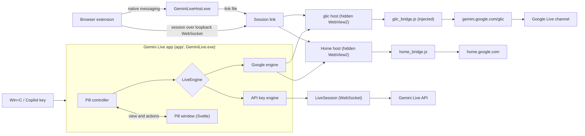
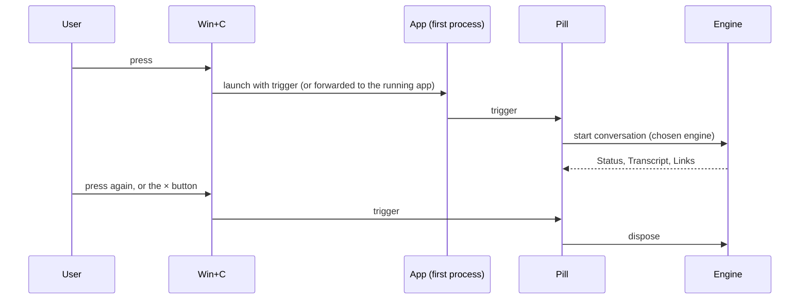
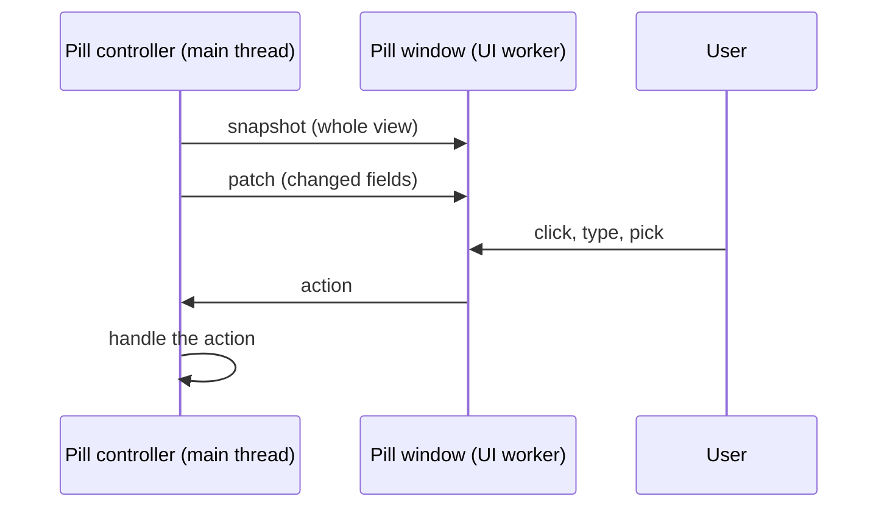
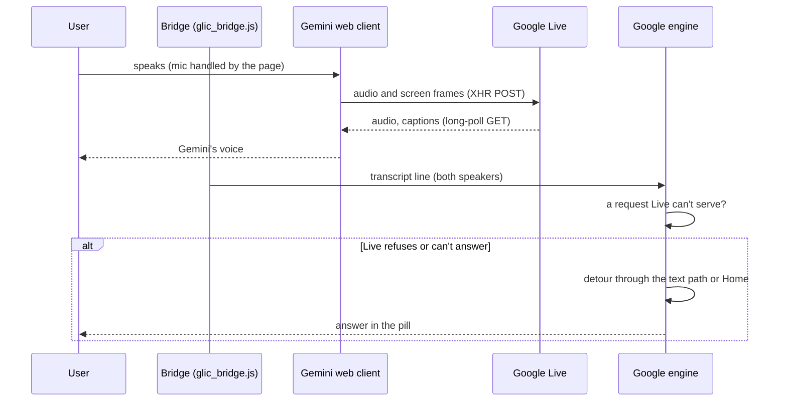
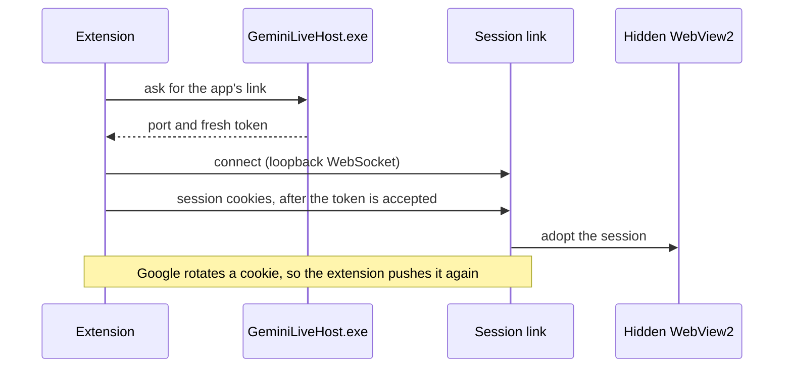
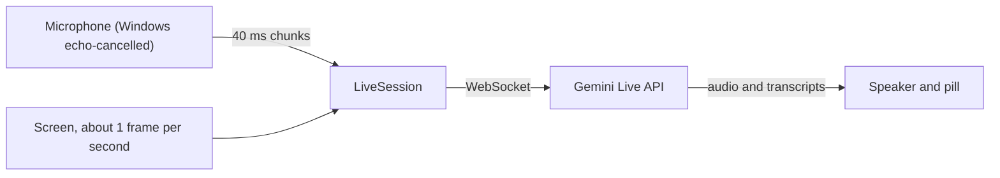
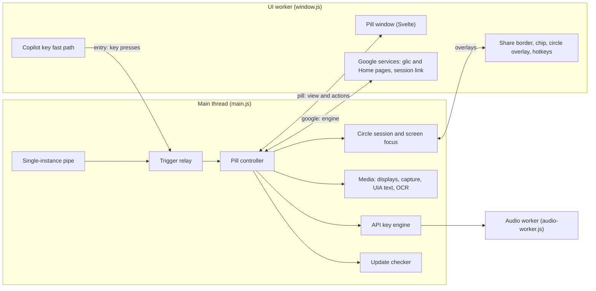
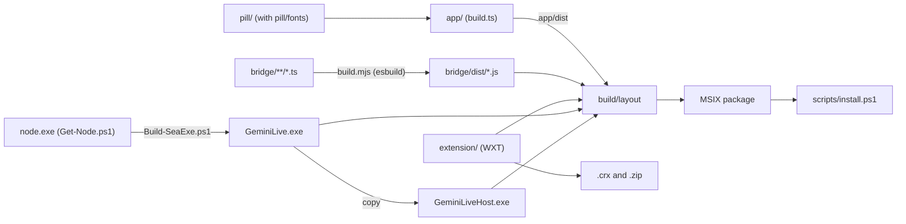

# Architecture

Gemini Live for Windows is a pill that starts a Gemini Live conversation on Win+C. A TypeScript app, one Node process, owns the engines, the hotkeys and the pill's state, and the pill itself is a Svelte window on [winui-svelte](https://github.com/avi12/winui-svelte) that the app's UI worker draws. It has two engines behind one interface: the default **Google account engine** drives the real Gemini web client in a hidden WebView2, and the **API key engine** talks to the public Live API directly. This document explains how the pieces fit, and why.

For setup and usage, see the [README](README.md).

## Goals and non-goals

**Goals**

- Win+C opens a conversation in about a second, with no visible browser.
- Gemini's own client does the audio, echo cancellation and voice, so the app never speaks text itself.
- The user's Google session stays owned by their browser.
- Each engine can be used alone, and the API key engine needs no browser.

**Non-goals**

- Not a general Gemini client. The app shows captions and links, and nothing else.
- Not affiliated with Google or Microsoft.

## System overview



The app is one Node process with a few worker threads. The pill is the only window the user sees. Everything else runs in hidden WebView2 pages or in sockets the app owns.

## Components

| Component | Where | Role |
| --- | --- | --- |
| Entry and single instance | `app/src/entry/`, `app/src/core/instance/` | The first process owns a named pipe. Later launches forward their trigger to it and exit. |
| Pill (UI) | `pill/` (Svelte on winui-svelte); the wire in `protocol/src/view.ts` | The window the user sees: state, captions, links, the gear menu and the setup panels. It owns no session logic; it draws the `view` it is sent and reports what the user did. Runs on the UI worker. |
| Pill (controller) | `app/src/pill/` | Owns the pill's state, builds the `view` from the engine and settings, and answers the actions. `host/` is the main thread's end of the pill link. |
| Engine interface | `app/src/contracts/live-engine.ts` | The one contract both engines satisfy: status, transcript, links, mute and start/stop. |
| Google engine | `app/src/google/` (`google-engine.ts`, `glic/`, `web-host/`) | Runs Gemini's web client in a hidden WebView2 and reads its state through the bridge. |
| Detours | `app/src/google/detours/` | Routes requests Live can't serve: lights to Home, app or web requests to Gemini's text path. |
| Home | `app/src/google/home-host.ts`, `app/src/google/protocols/home.ts` | Drives the PC lights through the Google Home web app. |
| API key engine | `app/src/live/` | Streams mic audio and screen frames to the public Live API over a WebSocket. Audio runs on its own worker (`app/src/media/audio/`). |
| Session link | `app/src/google/session/`, `app/src/core/link/` | Accepts the browser's Google session over a loopback WebSocket, one token per run. |
| Native host | `app/src/host.ts`, `app/src/core/native-host/` | The same exe, copied as `GeminiLiveHost.exe`: the native messaging program the extension calls to learn the app's link. |
| Bridges | `bridge/**/*.ts`, built to `bridge/dist/*.js` | Injected at document-start into the hidden pages. They install the host object, watch Live and answer the app. |
| Extension | `extension/` (WXT) | Pushes the Google session to the app whenever Google rotates it. |
| Updates | `app/src/core/updates/` | Polls the repository's `docs/updates.json` at start and every six hours, downloads a newer `.msix` and checks its SHA-256, then offers "Restart to update" in the gear menu. |
| Messaging | `messaging/` | Typed envelopes shared by the bridges, the extension and the app. |
| Settings and secrets | `app/src/core/settings/`, `app/src/core/secret/` | Engine choice in settings. The API key is stored with DPAPI for the Windows user. |
| Lint rules | `eslint-rules/`, `.oxlintrc.json` | Enforce the code style. |

## Flows

### Win+C



A second launch never starts a second app. It only forwards its trigger to the running one, then exits. The app is kept resident so the next Win+C is fast.

### The pill and its controller



The controller owns one state object, `view`: status, captions, links, displays, engine, update entry and the glow level. The pill never decides anything; it renders `view` and sends back actions such as mute, end, share, set engine or submit key. The first message is a `snapshot` of the whole view, every later one a `patch` of the fields that changed. The messages cross a `MessageChannel`, and both ends check each one against the same names and shapes (`protocol/src/view.ts`).
The pill runs on the UI worker, which owns the WinUI thread, since WinUI's message loop never gives its thread back.

### Google engine: one turn



Gemini's client owns the audio. The bridge only reads the Live wire to learn who spoke, and reports that to the app.

### Google session



The browser stays the only owner of the session. The app never rotates the cookies, so the two can't invalidate each other.

### API key engine



Mic chunks and screen frames are two producers writing to the same socket, so listening, looking and talking happen at once.

## The app (`app/`)

`app/` is the whole app in TypeScript on [winui-svelte](https://github.com/avi12/winui-svelte), the pill, engines and overlays in one process. `scripts/install.ps1` builds it: `app/` bundles into `main.js`, `window.js`, `host.js`, `audio-worker.js` and `uia-worker.js`, and `scripts/Build-SeaExe.ps1` turns the bundled `node.exe` into `GeminiLive.exe` (a single-executable application) with `package/AppxManifest.xml` as its manifest. The native messaging host is that same exe, copied as `GeminiLiveHost.exe`.



*Four `MessageChannel`s join the two threads, one per concern, and each carries a typed protocol. The main thread owns the state and the decisions; the UI worker owns everything that needs the window thread.*

- **Why two threads.** WinUI's message loop never gives its thread back, and a `WebView2` control, a window and a global hotkey all belong to the thread that made them. So the pill window, the overlays, the Copilot key's hidden window and the two Google pages live on the UI worker. The pill controller, settings, media and the API key engine stay on the main thread, which is never blocked by painting.
- **The Google engine crosses the link.** The glic page is a `WebView2`, so it runs on the UI worker. `google/remote/` is the link: `google-server.ts` runs the real engine there, and `google-client.ts` hands the controller a `LiveEngine` that looks like any other and forwards every call and event. Each message names its engine, since a stale one can still be winding down when the next starts.
- **One engine contract.** `contracts/live-engine.ts` is what the pill controller sees of either engine, including `onExtensionNeeded` (a session is wanted but the extension never connected) and `useCamera`. The controller subscribes to the running engine, so nothing about the extension or the camera is global.
- **Shared wire types.** `protocol/` holds what both `pill/` and `app/` read: the pill's `view` and `PillAction` schemas, the window messages, and the extension link. The window's own abilities (`bringToFront`, `moveBy`) travel on the pill's link and are answered on the UI worker (`pill/window-abilities.ts`).
- **Composition is in `wiring/`.** `main.ts`, `window.ts` and `host.ts` are three lines each. `wiring/start-app.ts` claims the instance, starts the Windows App SDK and builds the controller; `wiring/start-ui.ts` mounts the pill and starts the rest of the UI worker's parts, each failing alone.

| Folder (`app/src/`) | Role |
| --- | --- |
| `wiring/` | Builds the controller and the UI worker's parts over the real devices and links. |
| `contracts/` | The engine and monitor types every part agrees on. |
| `pill/` | The pill controller: state, captions, the view, the actions; the main thread's end of the pill link. |
| `google/` | The Google engine: glic and Home hosts, the session link, detours, and `remote/`. |
| `live/` | The API key engine over the public Live API. |
| `media/` | Displays, screen capture, screen text (UI Automation, OCR as the fallback), camera, and the audio graph on its own worker thread. |
| `overlays/` | The share border, focus chip, circle overlay and hotkeys, and the controller's end of their link. |
| `core/` | Settings, secrets, the log, updates, the single-instance pipe, the native host and extension setup. |
| `entry/` | How the process starts and hears the Copilot key: activation, DPI, the fast path. |
| `win32/`, `lib/` | Win32 binding helpers, and the small shared utilities. |

**Not proven without a packaged run on a real screen:** that the Copilot key's fast path is posted to the hidden window (checklist in `entry/index.ts`, spike in `scripts/Register-FastPathSpike.ps1`), that a `WebView2` parked off-screen on the UI worker keeps Chromium at full speed, that the SEA executable keeps its package identity and its per-monitor DPI, and that the overlays and hotkeys behave on the UI worker's message pump. The unit tests cover each part and each link.

## Key decisions

- **Gemini speaks, the app never does.** Answers from detours are shown as text. The app has no voice of its own, so the user always hears Gemini's voice.
- **One engine interface.** Both engines raise the same events, and the pill doesn't know which one is running. The API engine has no text turns, so its `Links` event is empty.
- **The pill's markup is Svelte, its logic stays on the main thread.** The UI is declarative and reads one `view`; engines, capture and settings stay in the controller, so the window can be rebuilt without touching a conversation.
- **Hidden pages, not a browser window.** The Google client runs in WebView2 with the bridge injected at document-start, so the user never sees a tab.
- **Injected JavaScript is generated.** The TypeScript bridges are the source. `bridge/build.mjs` writes the `.js` files into `bridge/dist`, and each file's first line says so.
- **Typed messages on every channel.** Each channel has a protocol map keyed by an enum, so a message name is written once and both ends use the same literal.
- **Detours instead of prompt hacks.** Live can't reach Google apps or serve links, so the app asks Gemini's text path, or Home, and shows the result. See [the Google apps note](docs/google-apps-in-live.md).
- **Captions come from the wire.** The bridge reads the speaker from the Live wire. The page's caption text is a fallback, used only while the wire carries no transcript. See [the transcript note](docs/live-transcript-wire.md).

## Known limits

- The Google engine depends on Gemini's web client and its Live protocol, which Google can change without notice.
- Google doesn't offer the Google engine for this use, and the account may be suspended. The README warns about this.
- Live can hang without a reply. The bridge restarts the session after 12 seconds of silence, once per unanswered request.
- Google-app requests in Live are refused on Google's side. Detours handle them, but Live's voice can still answer first.

## Build and run



`scripts/install.ps1` builds the app (with its pill), the bridges and the extension, lays them out in `build\layout`, then packages and installs them. Its `-Mode` switches between a signed local install (`Signed`), an unsigned development register (`Register`), the release files (`Release`) and a layout with nothing installed (`Stage`). `-HostExe Copy|Shared` chooses whether the native host is its own copy of the exe or the same one. See the README's "Build from source" section for the commands.

### Packaging

The installed app does not rely on anything the machine happens to have:

- **Node ships inside the package.** `app/dist` holds `main.js`, `window.js`, `host.js` and the workers, the native `@microsoft/dynwinrt` module, the Windows App SDK bootstrapper and the compiled styles. `Build-SeaExe.ps1` injects the entry into a copy of `node.exe` and writes `GeminiLive.exe` beside them, so the app never looks for Node on `PATH`. Machines mostly have no Node, or the wrong one, so bundling is the only way the app always starts. It costs about 90 MB more per package.
- **One Node version.** `bundledNodeVersion` in `package/build-config.json` is the only place it is written, and `minimumWindowsVersion` beside it is the only place for the Windows floor. `scripts/Get-Node.ps1` downloads that win-x64 zip from nodejs.org, checks its SHA-256 against the release's `SHASUMS256.txt` and the signature on `node.exe`, and caches `node.exe` and Node's MIT license in `build/node/<version>`. `install.ps1` copies the license into the layout as `node-LICENSE.txt`.
- **The Windows App SDK 2.2 runtime is a package dependency.** The manifest declares `Microsoft.WindowsAppRuntime.2` with a minimum of 2.2.0.0, since the pill's WinUI runs on it. A newer 2.x satisfies it. Windows does not fetch a sideloaded package's dependencies, so `scripts/Install-WindowsAppRuntime.ps1` installs the runtime first, from the manifest's own name and version: it downloads Microsoft's installer for that release and runs it only if its signature is valid and names Microsoft Corporation. `install.ps1` calls it for a local install, and `Install-GeminiLive.ps1` for a release, which ships the script beside the package.
- **Updates need nothing extra on an installed copy.** The runtime is already there from the first install, so App Installer updates the package in place. A release that raises the dependency's minimum needs the runtime installed by `Install-GeminiLive.ps1` first.

## Code layout

```
app/                   the whole app in TypeScript on winui-svelte (src/main.ts, src/window.ts, src/host.ts; src/wiring/ builds it)
  src/core/            settings, secrets, log, updates, single instance, native host, extension setup
  src/entry/           activation, DPI, the Copilot key fast path, the SEA stub
  src/pill/            the pill controller and its link
  src/google/          the Google engine: glic and Home hosts, detours, session link
  src/live/            the API key engine
  src/media/           displays, capture, screen text, camera, audio
  src/overlays/        share border, focus chip, circle overlay, hotkeys
pill/                  the pill's UI: Svelte on winui-svelte (src/, dev/, fonts/)
protocol/              the wire shared by the pill, the app and the extension: the pill view and actions, the extension link
bridge/                TypeScript injected into the hidden pages: glic/, home/, shared/ (built into dist/)
extension/             companion browser extension (WXT)
messaging/             typed message envelopes shared across channels
docs/                  design notes on Google apps and the Live wire
scripts/               install and release scripts, and the Node and Windows App SDK runtime fetchers
package/               MSIX manifest, icons and build-config.json
keys/                  extension signing key (git-ignored, never committed)
```

## Glossary

- **Glic**: Gemini in Chrome. The real Gemini web client at `gemini.google.com/glic`.
- **Live**: Gemini's real-time voice conversation mode.
- **Detour**: a request the app answers through the text path or Home, instead of through Live.
- **UI worker**: the thread that owns the WinUI message loop and draws the pill. The main thread sends it the `view` and receives the user's actions.
- **View**: the one state object the pill controller owns and the pill renders, sent as a snapshot and then patches.
- **Session link**: the loopback connection that carries the browser's Google session to the app.
