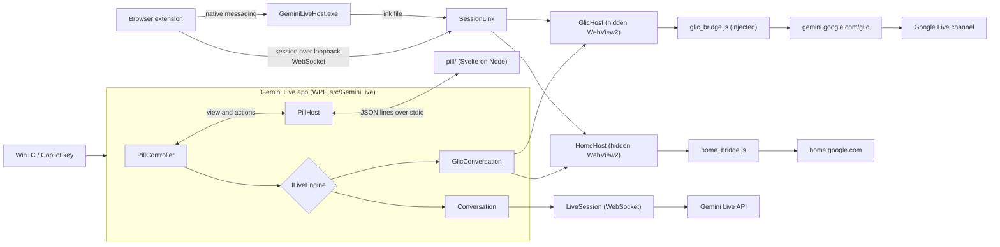
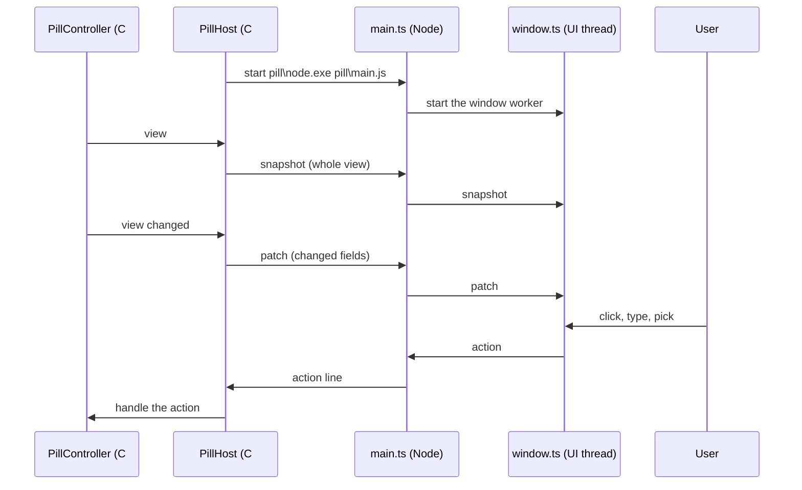
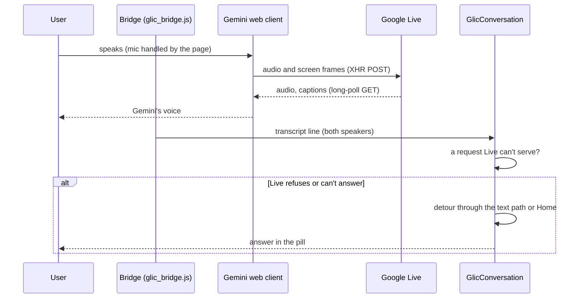
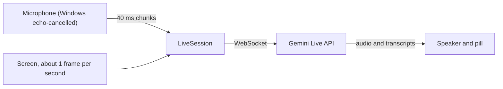
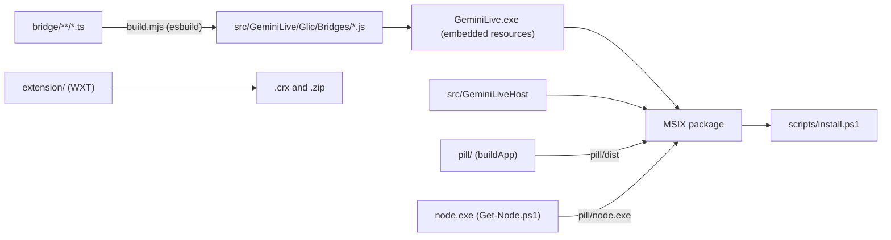

# Architecture

Gemini Live for Windows is a pill that starts a Gemini Live conversation on Win+C. A WPF app owns the engines, the hotkeys and the pill's state, and the pill itself is a Svelte window on [winui-svelte](https://github.com/avi12/winui-svelte) that the app runs as a sidecar. It has two engines behind one interface: the default **Google account engine** drives the real Gemini web client in a hidden WebView2, and the **API key engine** talks to the public Live API directly. This document explains how the pieces fit, and why.

For setup and usage, see the [README](README.md).

## Goals and non-goals

**Goals**

- Win+C opens a conversation in about a second, with no visible browser.
- Gemini's own client does the audio, echo cancellation and voice, so the app never speaks text itself.
- The user's Google session stays owned by their browser.
- Each engine can be used alone, and the API key engine needs no browser.

**Non-goals**

- Not a general Gemini client. The app shows captions and links, and nothing else.
- Not affiliated with Google or Microsoft.

## System overview



The app is one process, plus the pill's sidecar. The pill is the only window the user sees. Everything else runs in hidden WebView2 pages or in sockets the app owns.

## Components

| Component | Where | Role |
| --- | --- | --- |
| Entry and single instance | `App.xaml.cs`, `AppInstance.cs`, `CopilotKey.cs` | The first process owns a named mutex. Later launches forward their trigger to it and exit. |
| Pill (UI) | `pill/` (Svelte on winui-svelte): `src/main.ts`, `src/window.ts`, `src/protocol/view.ts` | The window the user sees: state, captions, links, the gear menu and the setup panels. It owns no session logic; it draws the `view` it is sent and reports what the user did. Runs as a Node sidecar, with its own `node.exe`. |
| Pill (host) | `Pill/PillHost.cs`, `Pill/PillController.cs`, `Pill/PillProtocol.cs` | `PillHost` starts and supervises the sidecar and speaks the line protocol. `PillController` owns the pill's state, builds the `view` from the engine and settings, and answers the actions. `PillProtocol` holds the message names and shapes. |
| Engine interface | `ILiveEngine.cs` | The one contract both engines satisfy: status, transcript, links, mute and start/stop. |
| Google engine | `Glic/Gemini/GlicConversation.cs`, `Glic/Gemini/GlicHost.cs`, `Glic/Gemini/GoogleWebViewHost.cs` | Runs Gemini's web client in a hidden WebView2 and reads its state through the bridge. |
| Detours | `Glic/Gemini/SpokenIntent.cs` | Routes requests Live can't serve: lights to Home, app or web requests to Gemini's text path. |
| Home | `Glic/Home/HomeHost.cs`, `Glic/Home/HomeProtocol.cs` | Drives the PC lights through the Google Home web app. |
| API key engine | `Conversation.cs`, `LiveSession.cs`, `LiveApi.cs`, `AudioEngine.cs`, `ScreenSource.cs` | Streams mic audio and screen frames to the public Live API over a WebSocket. |
| Session link | `Glic/Link/SessionLink.cs`, `Glic/Link/NativeHost.cs`, `Glic/Link/LinkFile.cs` | Accepts the browser's Google session over a loopback WebSocket, one token per run. |
| Native host | `src/GeminiLiveHost` | The small native messaging program the extension calls to learn the app's link. |
| Bridges | `bridge/**/*.ts`, built to `src/GeminiLive/Glic/Bridges/*.js` | Injected at document-start into the hidden pages. They install the host object, watch Live and answer the app. |
| Extension | `extension/` (WXT) | Pushes the Google session to the app whenever Google rotates it. |
| Updates | `Updates/ReleaseFeed.cs`, `Updates/UpdateChecker.cs`, `Updates/UpdateInstaller.cs` | Polls the repository's `docs/updates.json` at start and every six hours, downloads a newer `.msix` and checks its SHA-256, then offers "Restart to update" in the gear menu. |
| Messaging | `messaging/`, `Messaging.cs` | Typed envelopes shared by the bridges, the extension and the app. |
| Settings and secrets | `Settings.cs`, `UserSecret.cs` | Engine choice in settings. The API key is stored with DPAPI for the Windows user. |
| Lint analyzers | `analyzers/`, `eslint-rules/`, `.oxlintrc.json` | Enforce the code style on both the C# and TypeScript sides. |

## Flows

### Win+C


A second launch never starts a second app. It only forwards its trigger to the running one, then exits. The app is kept resident so the next Win+C is fast.

### The pill and its sidecar



The C# side owns one state object, `view`: status, captions, links, displays, engine, update entry and the glow level. The sidecar never decides anything; it renders `view` and sends back actions such as mute, end, share, set engine or submit key. The first line the host sends is a `snapshot` of the whole view, every later one a `patch` of the fields that changed. The wire is one JSON object per line over the sidecar's stdin and stdout, and both ends check each message against the same names and shapes (`pill/src/protocol/view.ts` and `Pill/PillProtocol.cs`).
`main.ts` is the relay: plain Node reading and writing the lines, forwarding them to the window. `window.ts` runs in a worker that owns the WinUI thread, since WinUI's message loop never gives its thread back.

### Google engine: one turn



Gemini's client owns the audio. The bridge only reads the Live wire to learn who spoke, and reports that to the app.

### Google session


The browser stays the only owner of the session. The app never rotates the cookies, so the two can't invalidate each other.

### API key engine



Mic chunks and screen frames are two producers writing to the same socket, so listening, looking and talking happen at once.

## Key decisions

- **Gemini speaks, the app never does.** Answers from detours are shown as text. The app has no voice of its own, so the user always hears Gemini's voice.
- **One engine interface.** Both engines raise the same events, and the pill doesn't know which one is running. The API engine has no text turns, so its `Links` event is empty.
- **The pill's markup is Svelte, its logic stays C#.** The UI is declarative and reads one `view`; engines, hotkeys, capture and settings stay in the WPF app, so the sidecar can be rebuilt or restarted without touching a conversation.
- **Hidden pages, not a browser window.** The Google client runs in WebView2 with the bridge injected at document-start, so the user never sees a tab.
- **Injected JavaScript is generated.** The TypeScript bridges are the source. `bridge/build.mjs` writes the `.js` files the app embeds, and each file's first line says so.
- **Typed messages on every channel.** Each channel has a protocol map keyed by an enum, so a message name is written once and both ends use the same literal.
- **Detours instead of prompt hacks.** Live can't reach Google apps or serve links, so the app asks Gemini's text path, or Home, and shows the result. See [the Google apps note](docs/google-apps-in-live.md).
- **Captions come from the wire.** The bridge reads the speaker from the Live wire. The page's caption text is a fallback, used only while the wire carries no transcript. See [the transcript note](docs/live-transcript-wire.md).

## Known limits

- The Google engine depends on Gemini's web client and its Live protocol, which Google can change without notice.
- Google doesn't offer the Google engine for this use, and the account may be suspended. The README warns about this.
- Live can hang without a reply. The bridge restarts the session after 12 seconds of silence, once per unanswered request.
- Google-app requests in Live are refused on Google's side. Detours handle them, but Live's voice can still answer first.

## Build and run



`scripts/install.ps1` builds the bridges, the extension, the pill and the app, then packages and installs them. Its `-Mode` switches between a signed local install, an unsigned development register, and the release files. See the README's "Build from source" section for the commands.

### Packaging the pill

The installed app does not rely on anything the machine happens to have:

- **Node ships inside the package.** `pill/` builds into a self-contained folder (`pill/dist`: `main.js`, `window.js`, the native `@microsoft/dynwinrt` module, the Windows App SDK bootstrapper and the compiled styles). The package holds it as `<app>\pill\`, with `node.exe` beside it. `PillHost` starts `pill\node.exe pill\main.js` from `AppContext.BaseDirectory`, with `pill\` as the working directory, and never looks for Node on `PATH`. Machines mostly have no Node, or the wrong one, so bundling is the only way the pill always starts. It costs about 90 MB more per package.
- **One Node version.** `BundledNodeVersion` in `Directory.Build.props` is the only place it is written. `scripts/Get-Node.ps1` downloads that win-x64 zip from nodejs.org, checks its SHA-256 against the release's `SHASUMS256.txt` and the signature on `node.exe`, and caches `node.exe` and Node's MIT license in `build/node/<version>`. `GeminiLive.csproj` copies them, with `pill/dist`, into the build, publish and package output as `pill\`; the license lands as `pill\node-LICENSE.txt`.
- **The Windows App SDK 2.2 runtime is a package dependency.** The manifest declares `Microsoft.WindowsAppRuntime.2` with a minimum of 2.2.0.0, since the pill's WinUI runs on it. A newer 2.x satisfies it. Windows does not fetch a sideloaded package's dependencies, so `scripts/Install-WindowsAppRuntime.ps1` installs the runtime first, from the manifest's own name and version: it downloads Microsoft's installer for that release and runs it only if its signature is valid and names Microsoft Corporation. `install.ps1` calls it for a local install, and `Install-GeminiLive.ps1` for a release, which ships the script beside the package.
- **Updates need nothing extra on an installed copy.** The runtime is already there from the first install, so App Installer updates the package in place. A release that raises the dependency's minimum needs the runtime installed by `Install-GeminiLive.ps1` first.

## Code layout

```
src/GeminiLive/                  WPF app (one namespace; folders group it by concern)
  App/                           startup, single instance, settings, log, secrets
  Keys/                          Win+C (Copilot key), Win+Alt+C and other global hotkeys
  Pill/                          PillHost, PillController, PillProtocol: the sidecar, the pill's state and the wire
  Overlays/                      floating-window chrome, share frame, focus chip
  CircleToSearch/                freeze-and-circle overlay, its geometry, Lens search
  Design/                        colour tokens, motion, icon glyphs (Fonts/ holds the fonts)
  Screen/                        displays, screen and webcam capture, screen text
  Engines/                       the engine contract; ApiKey/ is the Live API engine
  Interop/                       P/Invoke, typed JS messaging, wire names
  Updates/                       finds a newer GitHub release and hands its package to App Installer
  Glic/                          Gemini/ (Google engine), Home/, Link/ (session link), Bridges/ (bundles)
src/GeminiLiveHost/    native messaging host
pill/                  the pill's UI: Svelte on winui-svelte, run as a Node sidecar (src/main.ts, src/window.ts, src/protocol/)
bridge/                TypeScript injected into the hidden pages: glic/, home/, shared/
extension/             companion browser extension (WXT)
messaging/             typed message envelopes shared across channels
analyzers/             Roslyn analyzers for the C# style rules
docs/                  design notes on Google apps and the Live wire
scripts/               install and release scripts, and the Node and Windows App SDK runtime fetchers
package/               MSIX manifest and icons
keys/                  extension signing key (git-ignored, never committed)
```

## Glossary

- **Glic**: Gemini in Chrome. The real Gemini web client at `gemini.google.com/glic`.
- **Live**: Gemini's real-time voice conversation mode.
- **Detour**: a request the app answers through the text path or Home, instead of through Live.
- **Sidecar**: the Node process that draws the pill. The app starts it, sends it the `view` and receives the user's actions.
- **View**: the one state object the C# side owns and the pill renders, sent as a snapshot and then patches.
- **Session link**: the loopback connection that carries the browser's Google session to the app.
