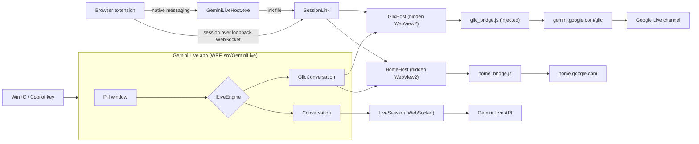
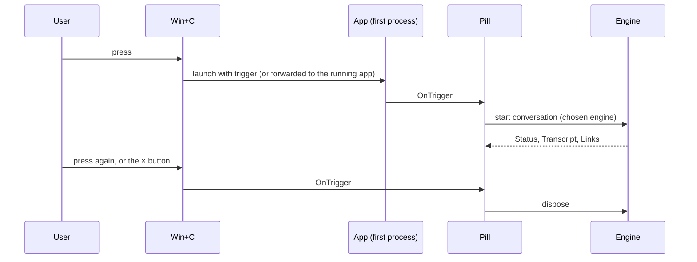
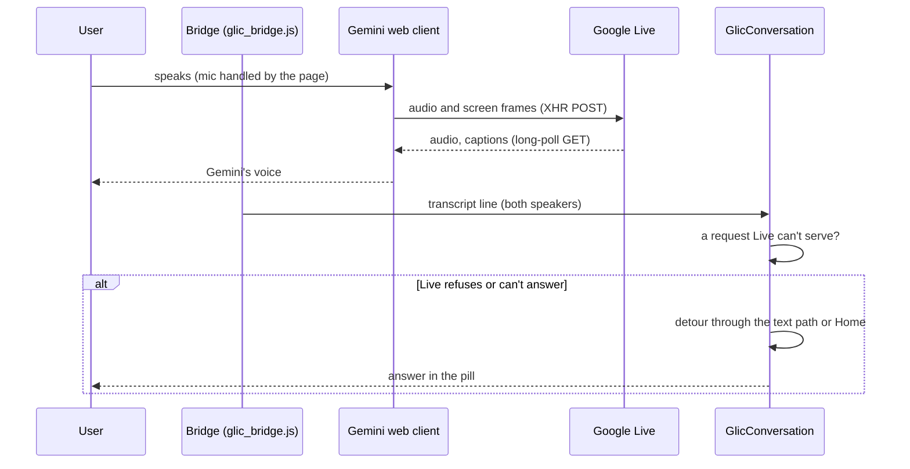
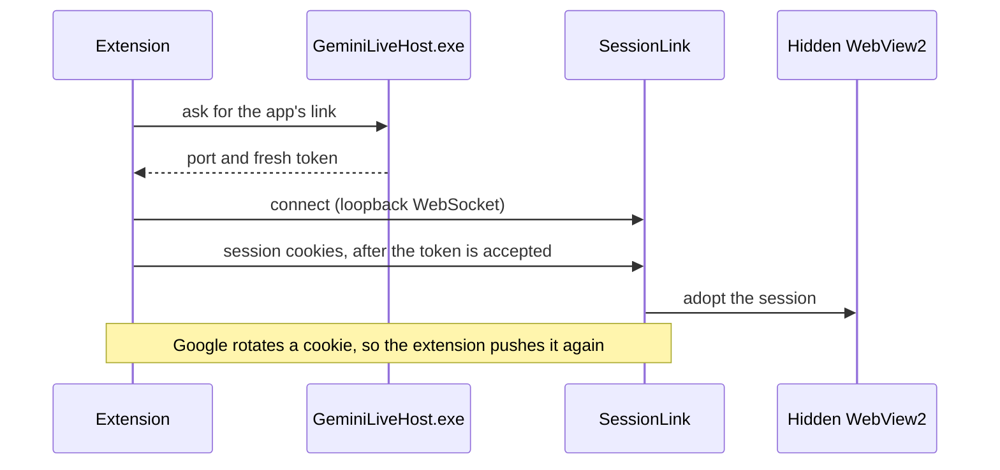
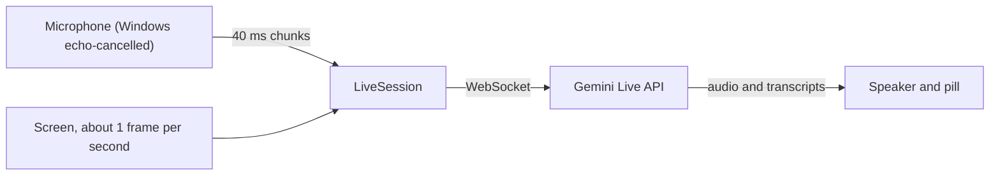
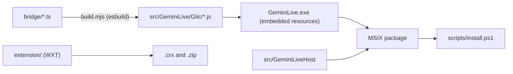

# Architecture

Gemini Live for Windows is a WPF pill that starts a Gemini Live conversation on Win+C. It has two engines behind one interface: the default **Google account engine** drives the real Gemini web client in a hidden WebView2, and the **API key engine** talks to the public Live API directly. This document explains how the pieces fit, and why.

For setup and usage, see the [README](README.md).

## Goals and non-goals

**Goals**

- Win+C opens a conversation in about a second, with no visible browser.
- Gemini's own client does the audio, echo cancellation and voice, so the app never speaks text itself.
- The user's Google session stays owned by their browser.
- Each engine can be used alone, and the API key engine needs no browser.

**Non-goals**

- Not a general Gemini client. The app shows captions and links, and nothing else.
- Not affiliated with Google or Microsoft.

## System overview



The app is one process. The pill is the only window the user sees. Everything else runs in hidden WebView2 pages or in sockets the app owns.

## Components

| Component | Where | Role |
| --- | --- | --- |
| Entry and single instance | `App.xaml.cs`, `AppInstance.cs`, `CopilotKey.cs` | The first process owns a named mutex. Later launches forward their trigger to it and exit. |
| Pill | `MainWindow.xaml(.cs)`, `Overlay.cs`, `HeightTransition.cs` | Shows state, captions and links, docked above the taskbar, and handles the engine menu. |
| Engine interface | `ILiveEngine.cs` | The one contract both engines satisfy: status, transcript, links, mute and start/stop. |
| Google engine | `Glic/GlicConversation.cs`, `Glic/GlicHost.cs`, `Glic/GoogleWebViewHost.cs` | Runs Gemini's web client in a hidden WebView2 and reads its state through the bridge. |
| Detours | `Glic/SpokenIntent.cs` | Routes requests Live can't serve: lights to Home, app or web requests to Gemini's text path. |
| Home | `Glic/HomeHost.cs`, `Glic/HomeProtocol.cs` | Drives the PC lights through the Google Home web app. |
| API key engine | `Conversation.cs`, `LiveSession.cs`, `LiveApi.cs`, `AudioEngine.cs`, `ScreenSource.cs` | Streams mic audio and screen frames to the public Live API over a WebSocket. |
| Session link | `Glic/SessionLink.cs`, `Glic/NativeHost.cs`, `Glic/LinkFile.cs` | Accepts the browser's Google session over a loopback WebSocket, one token per run. |
| Native host | `src/GeminiLiveHost` | The small native messaging program the extension calls to learn the app's link. |
| Bridges | `bridge/*.ts`, built to `src/GeminiLive/Glic/*.js` | Injected at document-start into the hidden pages. They install the host object, watch Live and answer the app. |
| Extension | `extension/` (WXT) | Pushes the Google session to the app whenever Google rotates it. |
| Messaging | `messaging/`, `Messaging.cs` | Typed envelopes shared by the bridges, the extension and the app. |
| Settings and secrets | `Settings.cs`, `UserSecret.cs` | Engine choice in settings. The API key is stored with DPAPI for the Windows user. |
| Lint analyzers | `analyzers/`, `eslint-rules/`, `.oxlintrc.json` | Enforce the code style on both the C# and TypeScript sides. |

## Flows

### Win+C



A second launch never starts a second app. It only forwards its trigger to the running one, then exits. The app is kept resident so the next Win+C is fast.

### Google engine: one turn



Gemini's client owns the audio. The bridge only reads the Live wire to learn who spoke, and reports that to the app.

### Google session



The browser stays the only owner of the session. The app never rotates the cookies, so the two can't invalidate each other.

### API key engine



Mic chunks and screen frames are two producers writing to the same socket, so listening, looking and talking happen at once.

## Key decisions

- **Gemini speaks, the app never does.** Answers from detours are shown as text. The app has no voice of its own, so the user always hears Gemini's voice.
- **One engine interface.** Both engines raise the same events, and the pill doesn't know which one is running. The API engine has no text turns, so its `Links` event is empty.
- **Hidden pages, not a browser window.** The Google client runs in WebView2 with the bridge injected at document-start, so the user never sees a tab.
- **Injected JavaScript is generated.** The TypeScript bridges are the source. `bridge/build.mjs` writes the `.js` files the app embeds, and each file's first line says so.
- **Typed messages on every channel.** Each channel has a protocol map keyed by an enum, so a message name is written once and both ends use the same literal.
- **Detours instead of prompt hacks.** Live can't reach Google apps or serve links, so the app asks Gemini's text path, or Home, and shows the result. See [the Google apps note](docs/google-apps-in-live.md).
- **Captions come from the wire.** The bridge reads the speaker from the Live wire. The page's caption text is a fallback, used only while the wire carries no transcript. See [the transcript note](docs/live-transcript-wire.md).

## Known limits

- The Google engine depends on Gemini's web client and its Live protocol, which Google can change without notice.
- Google doesn't offer the Google engine for this use, and the account may be suspended. The README warns about this.
- Live can hang without a reply. The bridge restarts the session after 12 seconds of silence, once per unanswered request.
- Google-app requests in Live are refused on Google's side. Detours handle them, but Live's voice can still answer first.

## Build and run



`scripts/install.ps1` builds the bridges, the extension and the app, then packages and installs them. Its `-Mode` switches between a signed local install, an unsigned development register, and the release files. See the README's "Build from source" section for the commands.

## Code layout

```
src/GeminiLive/        WPF app: pill, engines, audio, screen, settings
src/GeminiLive/Glic/   Google engine, session link, Home, bridge bundles
src/GeminiLiveHost/    native messaging host
bridge/                TypeScript injected into the hidden pages
extension/             companion browser extension (WXT)
messaging/             typed message envelopes shared across channels
analyzers/             Roslyn analyzers for the C# style rules
docs/                  design notes on Google apps and the Live wire
scripts/               install and release scripts
package/               MSIX manifest and icons
keys/                  extension signing key (git-ignored, never committed)
```

## Glossary

- **Glic**: Gemini in Chrome. The real Gemini web client at `gemini.google.com/glic`.
- **Live**: Gemini's real-time voice conversation mode.
- **Detour**: a request the app answers through the text path or Home, instead of through Live.
- **Session link**: the loopback connection that carries the browser's Google session to the app.
