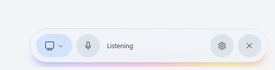

# Gemini Live for Windows

Press **Win+C** (or the Copilot key) and Gemini Live starts listening and sees the display you were working on. Talk over it any time, pick another display (or your webcam) from the flyout, and press Win+C again (or ×) to end.

Created by [Avi](https://avi12.com).



## Requirements

- Windows 11 (22H2 or newer)
- Chrome, Edge, Brave or another Chromium browser, signed in to the Google account you use Gemini with

## Install

Download the files from the [latest release](https://github.com/avi12/gemini-live-for-windows/releases/latest).

### The app

1. Put `GeminiLive-<version>.msix`, `GeminiLive.cer` and `Install-GeminiLive.ps1` in one folder.
2. In that folder, run:
   ```powershell
   powershell -ExecutionPolicy Bypass -File .\Install-GeminiLive.ps1
   ```
   The release is signed with a self-signed certificate, so the first install asks once (UAC) to trust it. Later versions install over it and keep your microphone permission.
3. **Set it as Win+C.** The script opens Settings › Personalization › Text input. Under **Customize Copilot key on keyboard**, choose **Gemini Live**. That setting covers both the Copilot key and Win+C.

### The browser extension

The extension hands the app your browser's Google session, so Gemini runs signed in as you.

1. Open `chrome://extensions` (`edge://extensions` in Edge) and turn on **Developer mode** (top right).
2. Drag `gemini-live-session-<version>-chrome.zip` from File Explorer onto the page.

The `.crx` in the release is the same extension, signed. You can drag it in the same way, but on Windows, Chrome may turn off an extension that didn't come from the Chrome Web Store, so the `.zip` is the reliable choice.

Stay signed in to Google in that browser. If you sign out there, Gemini Live waits until you sign back in.

## How it works

- **Google account engine (default).** The real Gemini web client (`gemini.google.com/glic`, the one behind Gemini in Chrome) runs in a hidden WebView2. It owns the mic, echo cancellation, the Live connection and Gemini's voice.
  - **Pictures:** it pulls screen stills from the app, a fresh one each second. The app announces the screen under a new tab id each time, since the client sends one picture per tab id.
  - **Text:** each picture comes with an exact text copy of the foreground window, read through UI Automation, so small text Gemini can't make out in the picture still reaches it word for word.
  - **Recovery:** a Live that breaks is retried with Gemini's own *Try again*, then reloaded, up to three times in ten minutes.
- **Your browser's Google session.** The companion extension pushes the session over a loopback WebSocket whenever Google rotates it. The app never rotates the cookies itself, so your browser stays the only owner of the session.
  - The socket has no fixed port. The app listens on a free one each run and hands it out, with a fresh token, through a native messaging host (`GeminiLiveHost.exe`). The browser lets only this extension's ID talk to that host.
  - The extension sends cookies only after the app greets it with that token.
- **API key engine (fallback, gear menu).** The public Gemini Live API over a WebSocket, with Windows' echo-cancelled audio and about one JPEG screen frame per second.

## Build from source

Needs the .NET 10 SDK, the Windows 10 SDK (for `makeappx` and `signtool`), Node 24 and pnpm.

```powershell
pnpm install
.\scripts\install.ps1                  # build, sign with a local certificate, install
.\scripts\install.ps1 -Mode Register   # unsigned dev-mode install for fast iteration
.\scripts\install.ps1 -Mode Release    # the release files, in build\release
```

Windows only lists signed providers in the Copilot key setting, so use the default mode to try Win+C. The release mode signs the extension's `.crx` with `keys\chrome.pem`, which git ignores; the extension's ID comes from that key.

| Path | What |
| --- | --- |
| `src/GeminiLive` | the WPF app |
| `src/GeminiLiveHost` | the native messaging host the extension asks for the app's link |
| `bridge/` | the TypeScript injected into the hidden Gemini and Google Home pages |
| `extension/` | the companion browser extension (WXT) |
| `messaging/` | typed messaging, in [@webext-core/messaging](https://webext-core.aklinker1.io/messaging/)'s protocol-map style, shared by the bridges, the extension and (as `Messaging.cs`) the app |
| `analyzers/` | the C# side of the lint rules |
| `package/` | the MSIX manifest and assets |

### Lint

```powershell
pnpm dev:lint   # fallow, oxlint + ESLint, and dotnet format
```

TypeScript follows the youtube-time-manager setup: oxlint for logic, ESLint for layout, fallow for dead code and complexity. The C# side mirrors the same rules through `.editorconfig` and the analyzers in `analyzers/`. A pre-commit hook runs them on staged files.

## Debugging

- Log: `%LOCALAPPDATA%\GeminiLive\log.txt`.
- Create `%LOCALAPPDATA%\GeminiLive\debug.flag` to turn on DevTools and CDP for the hidden pages, each on a free port the log names (`glic: devtools on localhost:<port>`), and to keep the overlays visible in screenshots.

## License

[Apache License 2.0](LICENSE). Forks and other redistributions must keep the [NOTICE](NOTICE) file and credit [Avi](https://avi12.com) in their documentation and in any about or credits screen.

Not affiliated with Google or Microsoft.
